# SportKids: API e portal de brinquedos esportivos (AC4, Spring Boot)

Projeto da AC4 da disciplina de Programação com Spring Boot do Ibmec.

| | |
|---|---|
| **Integrantes** | Gustavo Andrade Amorim, RA 202508703858 · João Pedro Goes, RA 202503436541 |
| **IDE utilizada** | IntelliJ IDEA |
| **Repositório** | https://github.com/Gudradee/SportKids |

## 1. Descrição do projeto

O SportKids é um sistema para uma empresa de brinquedos esportivos voltados a crianças de até 15 anos. Ele tem uma API REST em `/brinquedos` com o CRUD completo em JSON, testada pelo Postman em `http://localhost:8080`, e guarda os dados no banco H2, na tabela `TDS_TB_Brinquedos`, por meio do Spring Data JPA.

Os dados de entrada passam pelo Bean Validation (a classificação etária, por exemplo, vai de 0 a 15 anos), e o acesso é controlado pelo Spring Security, com tela de login e dois perfis: USER, que só consulta, e ADMIN, que pode cadastrar, editar e excluir. Por fim, há uma interface web feita com Thymeleaf, com uma landing page pública, a tela de login e uma área restrita com listagem e formulários.

## 2. Tecnologias e dependências

| Tecnologia | Uso no projeto |
|---|---|
| Java 17 | Linguagem |
| Spring Boot 4.1 (Maven) | Framework base, com Tomcat embutido na porta 8080 |
| Spring Web MVC | Endpoints REST e controllers das páginas |
| Spring Data JPA (Hibernate) | Persistência e `JpaRepository` |
| H2 Database e H2 Console | Banco SQL em memória e console web |
| Validation (Hibernate Validator) | Bean Validation (`@NotBlank`, `@Max`, `@Pattern`...) |
| Spring Security | Login, perfis USER e ADMIN, HTTP Basic e CSRF |
| Thymeleaf e `thymeleaf-extras-springsecurity6` | Páginas HTML e `sec:authorize` (esta última adicionada pelo mvn repository) |
| Spring Boot DevTools | Reinício automático durante o desenvolvimento |
| JUnit 5, MockMvc e Spring Security Test | Testes automatizados |

O projeto foi gerado no Spring Initializr com essas configurações:

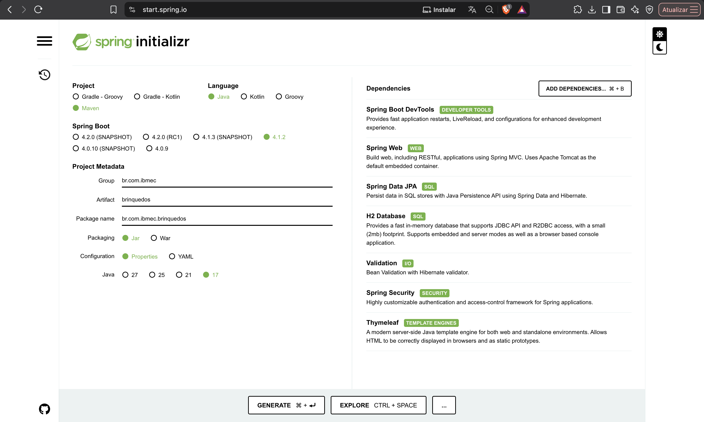

Tela final do start.spring.io usada para criar o projeto: Maven, Java 17, Spring Boot 4.1.2, grupo `br.com.ibmec`, artefato `brinquedos` e as sete dependências escolhidas, de Spring Web e Spring Data JPA até Spring Security e Thymeleaf.

## 3. Arquitetura

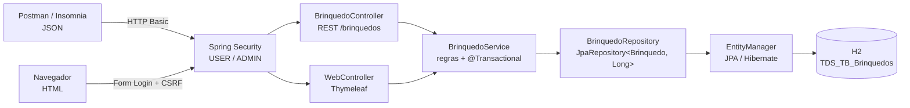

O código está organizado em camadas, dentro do pacote base `br.com.ibmec.brinquedos`:

```
src/main/java/br/com/ibmec/brinquedos/
├── BrinquedosApplication.java        # ponto de entrada (main)
├── config/
│   ├── SecurityConfig.java           # regras do Spring Security (2 cadeias: API e Web)
│   ├── SegurancaProperties.java      # usuários e senhas lidos do application.properties
│   ├── ApiSecurityErrorHandler.java  # respostas 401/403 em JSON para a API
│   └── DataLoader.java               # carrega 4 brinquedos ao iniciar
├── controller/
│   ├── BrinquedoController.java      # API REST /brinquedos (CRUD)
│   └── WebController.java            # páginas Thymeleaf
├── dto/
│   ├── BrinquedoRequest.java         # dados de entrada (sem id) com Bean Validation
│   ├── BrinquedoLoteRequest.java     # entrada do cadastro em lote (lista)
│   ├── BrinquedoResponse.java        # dados de saída
│   └── ErroResponse.java             # formato padrão de erro
├── exception/
│   ├── BrinquedoNaoEncontradoException.java
│   └── GlobalExceptionHandler.java   # converte exceções em JSON (400/404/500)
├── model/
│   └── Brinquedo.java                # @Entity mapeada para a tabela TDS_TB_Brinquedos
├── repository/
│   ├── BrinquedoRepository.java      # JpaRepository<Brinquedo, Long> e consultas derivadas
│   ├── BrinquedoRepositoryCustom.java # declara a consulta escrita à mão
│   └── BrinquedoRepositoryImpl.java  # implementa essa consulta com EntityManager e JPQL
└── service/
    └── BrinquedoService.java         # regras de negócio e transações
src/main/resources/
├── application.properties
├── static/css/estilo.css
└── templates/  (index, login, brinquedos, admin/form, error/403, error/404, fragments/layout)
```

Cada camada tem um papel só. O controller traduz o HTTP, o service concentra a regra de negócio (usada tanto pela API quanto pelas páginas) e o repository é o único que acessa o banco. Os DTOs separam o formato da API da entidade do banco, e é por isso que o cliente não consegue mandar o `id` no JSON, o que protege contra mass assignment.

## 4. Como executar

O único pré-requisito é ter o JDK 17 ou superior. O Maven já vem embutido no projeto pelo `mvnw`.

```bash
./mvnw spring-boot:run        # no Windows: mvnw.cmd spring-boot:run
```

No IntelliJ, basta abrir a pasta do projeto e executar a classe `BrinquedosApplication`.

| Recurso | Endereço |
|---|---|
| Landing page (pública) | http://localhost:8080/ |
| Login | http://localhost:8080/login |
| Área logada | http://localhost:8080/app/brinquedos |
| API REST | http://localhost:8080/brinquedos |
| Console H2 (só ADMIN) | http://localhost:8080/h2-console, com JDBC URL `jdbc:h2:mem:brinquedosdb`, usuário `sa` e senha vazia |

**Credenciais de teste**

| Usuário | Senha | Perfis | Permissões |
|---|---|---|---|
| `user` | `user123` | USER | Consultar (GET) e ver a listagem |
| `admin` | `admin123` | ADMIN, USER | CRUD completo e console H2 |

As senhas não ficam fixas no código Java. Elas estão no `application.properties`, podem ser trocadas pelas variáveis de ambiente `APP_USER_PASSWORD` e `APP_ADMIN_PASSWORD` sem recompilar e são guardadas em memória com hash BCrypt.

Para rodar os 12 testes automatizados (CRUD, validação, EntityManager e segurança):

```bash
./mvnw test
```

## 5. Modelo de dados: tabela `TDS_TB_Brinquedos`

A entidade [`Brinquedo`](src/main/java/br/com/ibmec/brinquedos/model/Brinquedo.java) é mapeada com `@Entity` e `@Table(name = "TDS_TB_Brinquedos")`, e o Hibernate cria a tabela sozinho ao iniciar (`ddl-auto=update`).

| Coluna | Tipo Java | Validações (Bean Validation) | Regra |
|---|---|---|---|
| **Id** | `Long` | Gerado pelo banco (`IDENTITY`) | Chave primária com auto incremento |
| **Nome** | `String` | `@NotBlank`, `@Size(min=2, max=100)` | Obrigatório, de 2 a 100 caracteres |
| **Tipo** | `String` | `@NotBlank`, `@Size(max=50)` | Categoria: Bola, Raquete, Patins... |
| **Classificacao** | `Integer` | `@NotNull`, `@Min(0)`, `@Max(15)` | Idade mínima, já que a empresa atende até 15 anos |
| **Tamanho** | `String` | `@NotBlank`, `@Pattern("P\|M\|G\|UNICO")` | Apenas P, M, G ou UNICO |
| **Preco** | `BigDecimal` | `@NotNull`, `@DecimalMin("0.01")`, `@Digits(8,2)` | Maior que zero, com 2 casas decimais |

A validação acontece assim: os controllers recebem o DTO com `@Valid` e, se alguma regra falhar, o Spring lança `MethodArgumentNotValidException`, que o `GlobalExceptionHandler` transforma numa resposta 400 com o erro de cada campo. As mesmas regras também estão na entidade, então o Hibernate confere tudo de novo antes de gravar. O preço usa `BigDecimal` porque `double` gera erros de arredondamento com dinheiro.

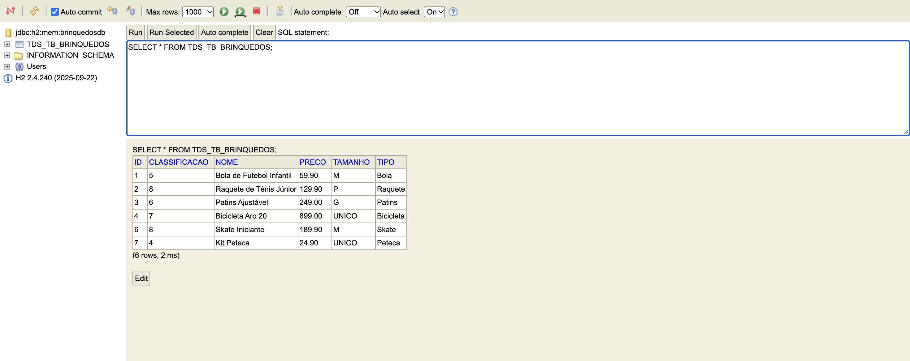

Console do H2 aberto como admin, com o `SELECT * FROM TDS_TB_BRINQUEDOS` mostrando a tabela e suas colunas obrigatórias. As linhas são os 4 brinquedos iniciais mais os 2 do cadastro em lote; o id 5 não aparece porque foi criado e depois excluído nos testes do Postman.

## 6. Repository: `JpaRepository<Brinquedo, Long>`

```java
public interface BrinquedoRepository extends JpaRepository<Brinquedo, Long>, BrinquedoRepositoryCustom {
    List<Brinquedo> findByTipoIgnoreCase(String tipo);
    List<Brinquedo> findByClassificacaoLessThanEqual(Integer idade);
    List<Brinquedo> findByNomeContainingIgnoreCase(String nome);
}
```

`JpaRepository<T, K>` é uma interface genérica do Spring Data. O `T` é a entidade que o repositório gerencia, aqui `Brinquedo`, e o `K` é o tipo da chave primária, aqui `Long`. Só por estender essa interface, o repositório já ganha os métodos abaixo, sem nenhuma linha de SQL:

| Método herdado | SQL equivalente | Onde usamos |
|---|---|---|
| `save(entidade)` | `INSERT` (sem id) ou `UPDATE` (com id) | POST e PUT |
| `saveAll(lista)` | vários `INSERT` | POST `/brinquedos/lote` e `DataLoader` |
| `findAll(Sort)` | `SELECT * ... ORDER BY id` | GET `/brinquedos` |
| `findById(id)` | `SELECT ... WHERE id = ?` (retorna `Optional`) | GET `/brinquedos/{id}` e PUT |
| `existsById(id)` | `SELECT COUNT(*) ... WHERE id = ?` | DELETE |
| `deleteById(id)` | `DELETE ... WHERE id = ?` | DELETE |
| `count()` | `SELECT COUNT(*)` | Landing page e `DataLoader` |

Os outros três métodos são query methods: o Spring lê o nome do método e monta a consulta. `findByTipoIgnoreCase("bola")` vira `WHERE UPPER(tipo) = UPPER('bola')`, `findByClassificacaoLessThanEqual(8)` vira `WHERE classificacao <= 8` e `findByNomeContainingIgnoreCase` vira um `LIKE '%...%'`.

Por baixo, nós escrevemos só a interface. Quando a aplicação sobe, o Spring Data gera uma classe (um proxy) que implementa esses métodos usando o `EntityManager` do JPA, e cada chamada roda numa transação com commit automático no final. No service, o `@Transactional` junta várias operações numa transação só; no cadastro em lote, por exemplo, ou tudo é gravado ou nada é.

Nem toda consulta precisa vir do nome do método. Para a busca por faixa de preço, o repositório também estende `BrinquedoRepositoryCustom`, implementada em [`BrinquedoRepositoryImpl`](src/main/java/br/com/ibmec/brinquedos/repository/BrinquedoRepositoryImpl.java) com o `EntityManager` direto:

```java
@PersistenceContext
private EntityManager entityManager;

public List<Brinquedo> buscarPorFaixaDePreco(BigDecimal min, BigDecimal max) {
    String jpql = "SELECT b FROM Brinquedo b WHERE b.preco BETWEEN :min AND :max ORDER BY b.preco";
    TypedQuery<Brinquedo> query = entityManager.createQuery(jpql, Brinquedo.class);
    query.setParameter("min", min);
    query.setParameter("max", max);
    return query.getResultList();
}
```

O Spring Data encontra essa classe pelo sufixo `Impl` e junta o método aos que vêm do `JpaRepository`. A consulta é escrita em JPQL, que trabalha com a classe `Brinquedo` em vez da tabela, e recebe os valores por parâmetros nomeados (`:min` e `:max`), o que impede SQL Injection. Assim fica claro o papel do EntityManager que aparece no diagrama do enunciado: é o objeto do JPA que gerencia as entidades e executa as consultas, o mesmo que o `JpaRepository` usa por baixo.

No POST e no PUT, o caminho segue a sugestão do enunciado: o JSON do Postman vira um objeto Java (o DTO), no cadastro em lote esses objetos são reunidos numa List dentro do programa, e depois `save` ou `saveAll` gravam tudo no banco com um commit.

## 7. Endpoints REST

A base é `http://localhost:8080`, e a autenticação é feita no Postman em Authorization, com o tipo Basic Auth.

| Método | Endpoint | Perfil | Descrição | Sucesso |
|---|---|---|---|---|
| GET | `/brinquedos` | USER, ADMIN | Lista todos. Filtros opcionais: `?tipo=`, `?idade=`, `?nome=` | 200 |
| GET | `/brinquedos/{id}` | USER, ADMIN | Busca por id | 200 / 404 |
| GET | `/brinquedos/faixa-preco?min=&max=` | USER, ADMIN | Filtra por preço (consulta com EntityManager) | 200 / 400 |
| POST | `/brinquedos` | ADMIN | Cria um brinquedo | 201 com `Location` |
| POST | `/brinquedos/lote` | ADMIN | Cria vários (lista) numa transação | 201 |
| PUT | `/brinquedos/{id}` | ADMIN | Atualiza um brinquedo | 200 / 404 |
| DELETE | `/brinquedos/{id}` | ADMIN | Exclui pelo id | 204 / 404 |

Exemplo de corpo para POST e PUT:

```json
{
  "nome": "Bola de Vôlei Kids",
  "tipo": "Bola",
  "classificacao": 8,
  "tamanho": "M",
  "preco": 79.90
}
```

A collection pronta está em [`postman/AC4-Brinquedos.postman_collection.json`](postman/AC4-Brinquedos.postman_collection.json) e pode ser aberta no Postman pelo Import. Cada requisição já tem um teste automático de status, e o ideal é rodar todas em ordem logo depois de iniciar a aplicação.

## 8. Testes de CRUD no Postman

### 8.1 Listar todos os brinquedos (200 OK)

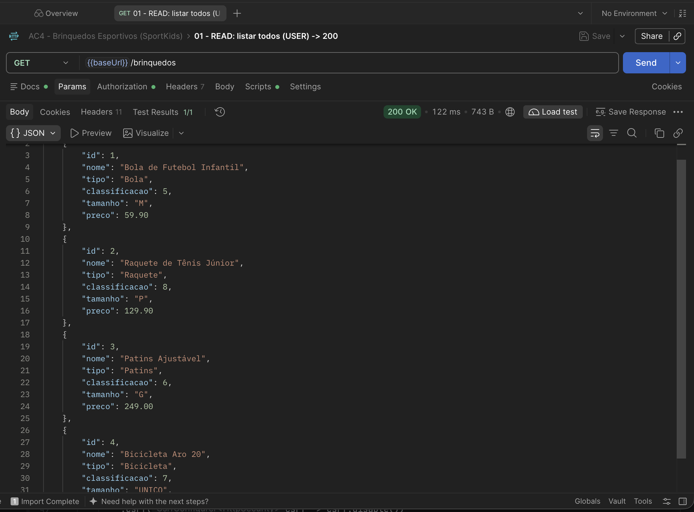

Um GET em `/brinquedos` logado como user devolve a lista completa em JSON, com os 4 brinquedos que o `DataLoader` cadastra quando a aplicação sobe.

### 8.2 Buscar um brinquedo pelo id (200 OK)

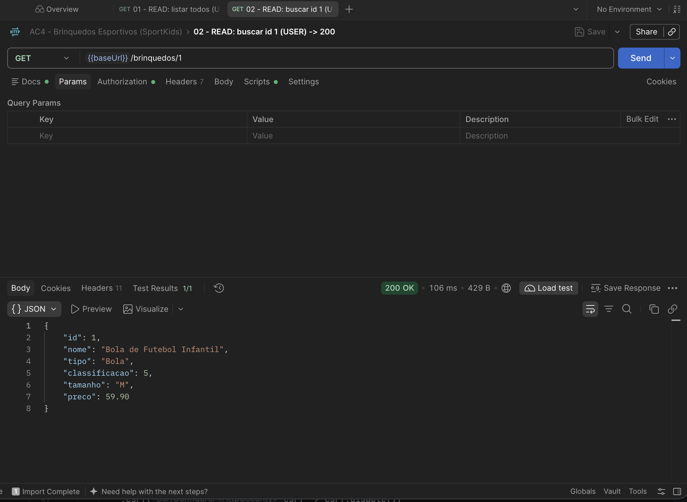

O GET em `/brinquedos/1` traz só o brinquedo de id 1, a Bola de Futebol Infantil.

### 8.3 Buscar um id que não existe (404 Not Found)

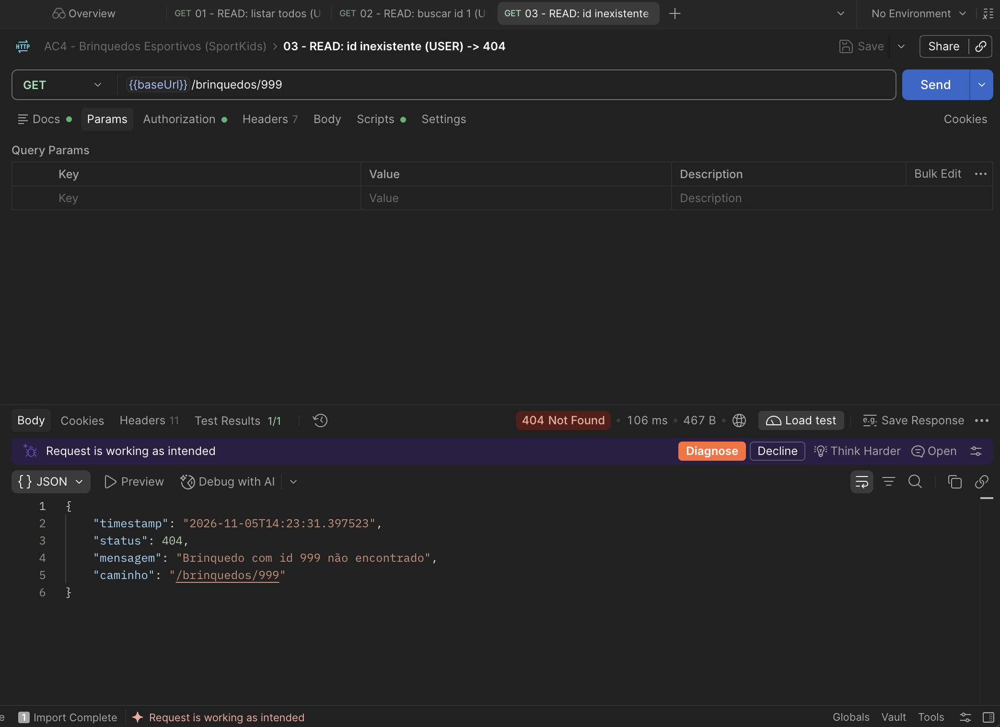

Quando o id não existe, como o 999, a API não quebra: responde 404 com uma mensagem clara dizendo que o brinquedo não foi encontrado.

### 8.4 Filtrar por tipo (200 OK)

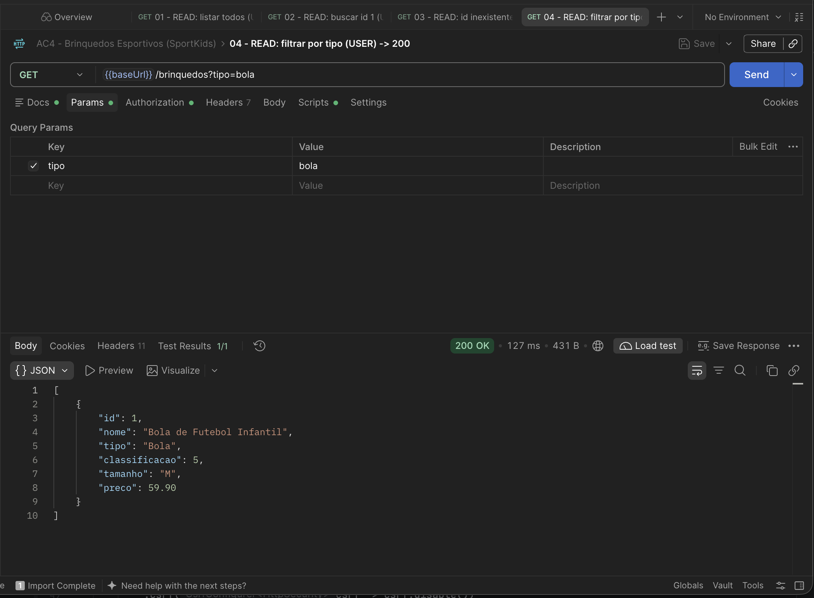

Com `?tipo=bola` na URL, a busca usa o query method `findByTipoIgnoreCase` e devolve só as bolas, sem diferenciar maiúsculas de minúsculas.

### 8.5 Cadastrar um brinquedo como admin (201 Created)

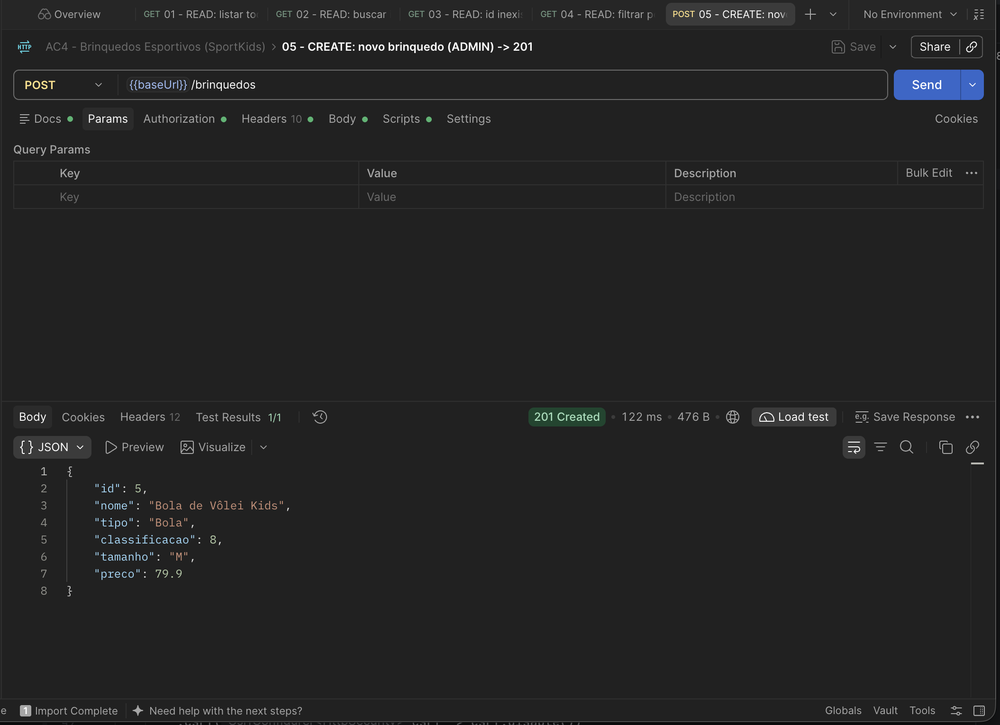

Logado como admin, o POST envia a Bola de Vôlei Kids em JSON e recebe 201. O brinquedo volta com o id 5 gerado pelo banco, e a resposta também traz o header `Location: /brinquedos/5`.

### 8.6 Tentar cadastrar como user (403 Forbidden)

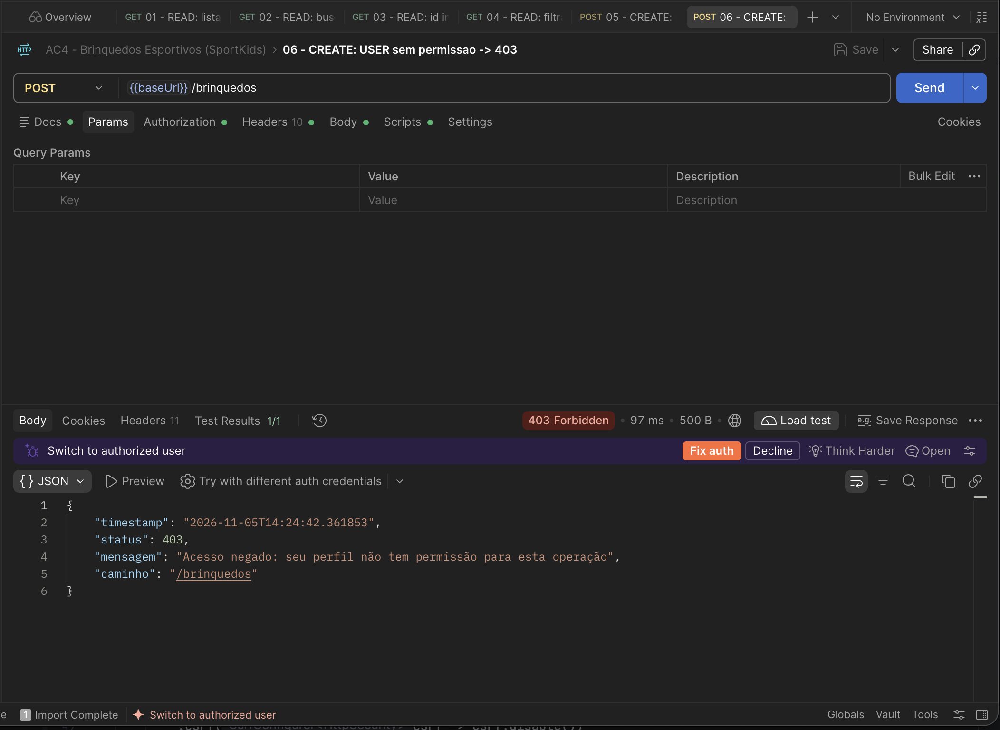

O mesmo POST feito com o usuário user é barrado pelo Spring Security, porque esse perfil só tem permissão de consulta.

### 8.7 Cadastrar com dados inválidos (400 Bad Request)

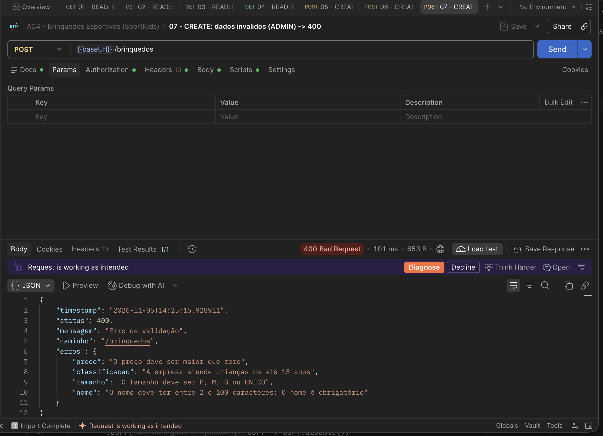

Aqui o JSON vai com nome vazio, classificação 20, tamanho XX e preço zero. O Bean Validation recusa o cadastro e devolve a mensagem de erro de cada campo, e nada é gravado.

### 8.8 Atualizar o brinquedo criado (200 OK)

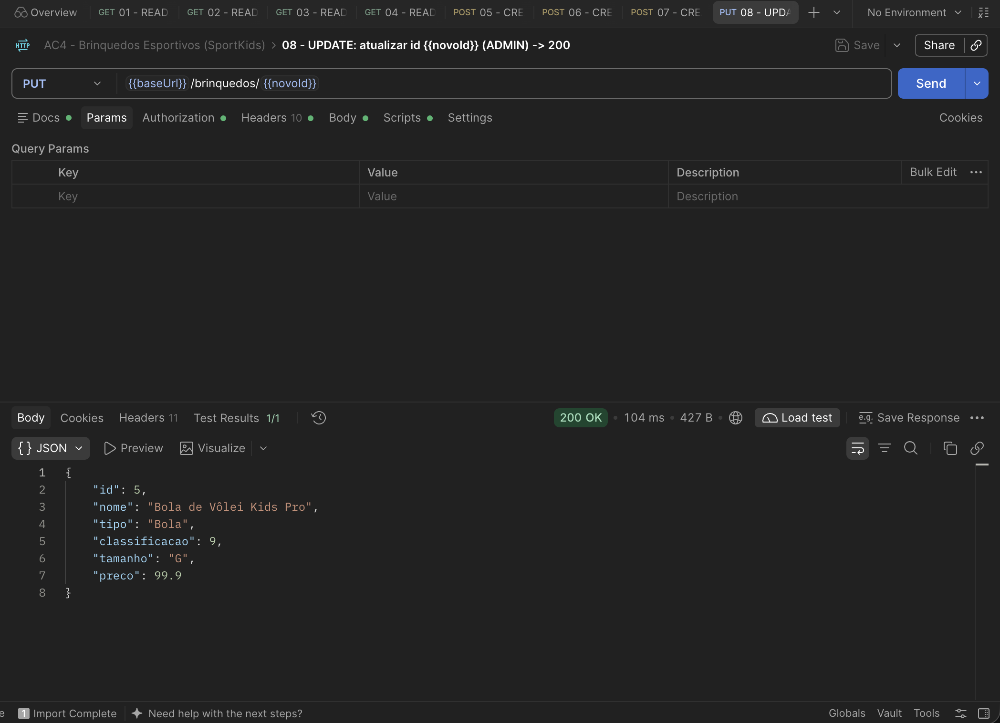

O PUT em `/brinquedos/5` troca os dados do brinquedo criado no 8.5, que passa a se chamar Bola de Vôlei Kids Pro, com tamanho G e novo preço. O id continua o mesmo.

### 8.9 Excluir o brinquedo pelo id (204 No Content)

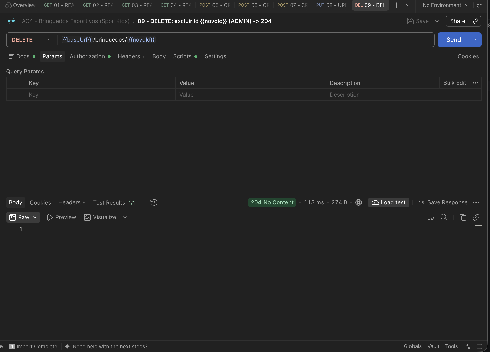

O DELETE em `/brinquedos/5` apaga o registro. O 204 indica que deu certo e que não há conteúdo para devolver.

### 8.10 Excluir de novo o mesmo id (404 Not Found)

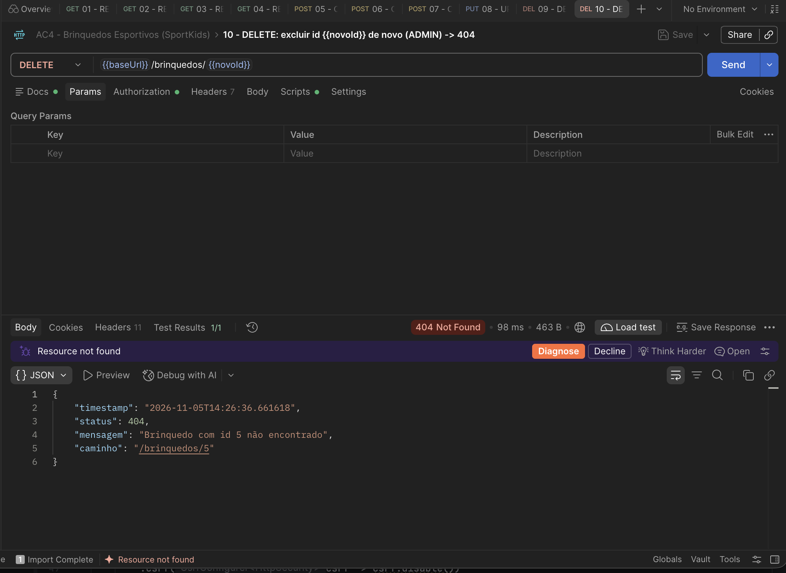

Repetir o DELETE no id 5 retorna 404, o que comprova que o registro realmente saiu do banco.

### 8.11 Acessar sem login (401 Unauthorized)

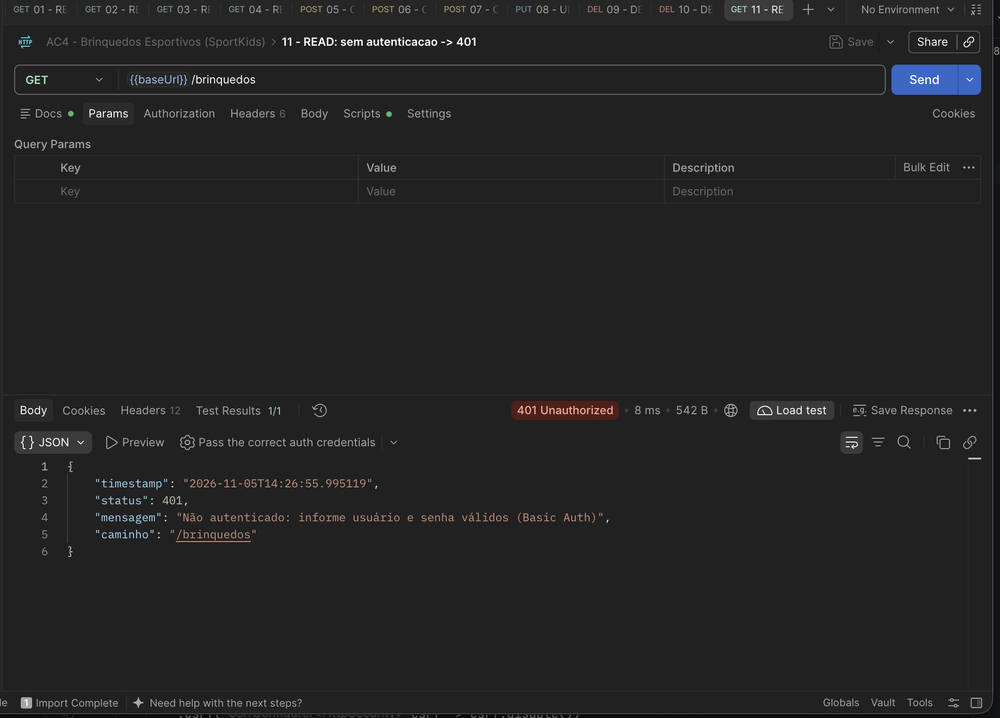

Sem nenhuma credencial (Auth Type em No Auth), a API responde 401 e pede usuário e senha válidos.

### 8.12 Extra: cadastro em lote (201 Created)

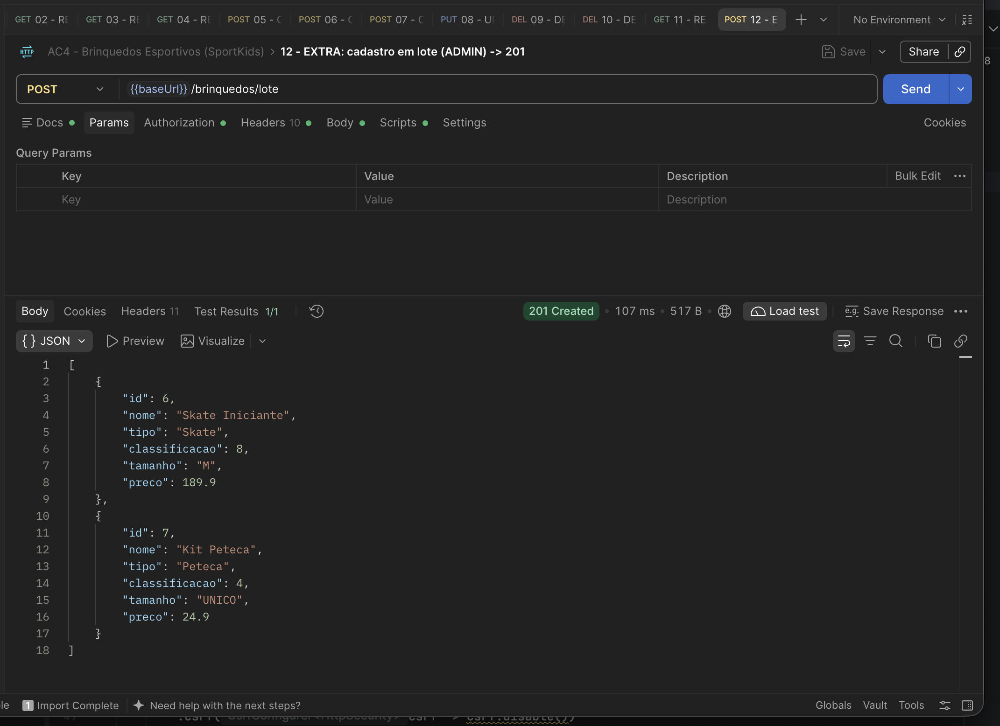

O POST em `/brinquedos/lote` manda dois brinquedos de uma vez, o Skate Iniciante e o Kit Peteca. Eles são reunidos numa lista no programa e gravados juntos com `saveAll`, numa única transação, recebendo os ids 6 e 7.

### 8.13 Extra: faixa de preço com EntityManager (200 OK)

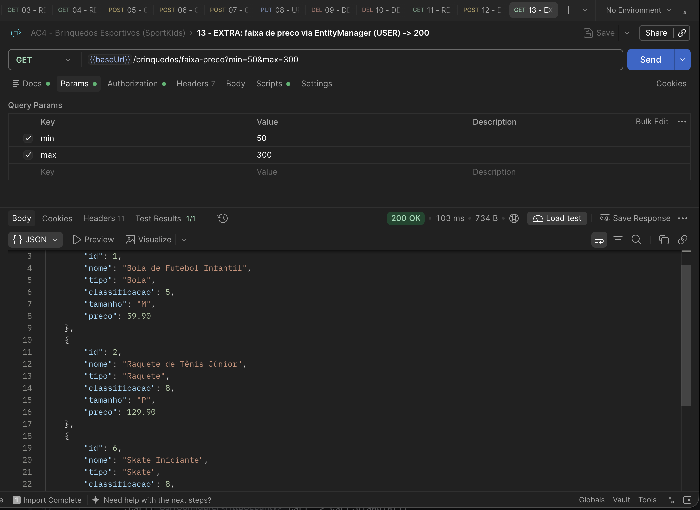

Com `min=50` e `max=300`, a consulta feita em JPQL pelo EntityManager devolve os brinquedos dentro dessa faixa, do mais barato para o mais caro. Se o mínimo for maior que o máximo, ou se faltar algum dos dois, a resposta é 400.

## 9. Spring Security

A configuração está em [`SecurityConfig`](src/main/java/br/com/ibmec/brinquedos/config/SecurityConfig.java) e usa duas cadeias de filtros, uma para cada tipo de cliente:

| Cadeia | Atende | Autenticação | Sessão | CSRF |
|---|---|---|---|---|
| `@Order(1)` API | `/brinquedos/**` (Postman) | HTTP Basic | Stateless (sem cookie) | Desligado, já que sem cookie não há risco de CSRF |
| `@Order(2)` Web | todo o resto (navegador) | Form Login (`/login`) | Sessão | Ligado em todos os formulários |

**Regras de acesso**

| Recurso | Acesso |
|---|---|
| `/`, `/login`, `/css/**`, `/error` | Público |
| `GET /brinquedos/**` | USER ou ADMIN |
| `POST`, `PUT` e `DELETE /brinquedos/**` | Somente ADMIN |
| `/app/**` | USER ou ADMIN (logado) |
| `/app/admin/**` e `/h2-console/**` | Somente ADMIN |

Além das regras, o projeto segue algumas boas práticas de segurança. As senhas usam hash BCrypt e podem ser definidas por variável de ambiente, o DTO não aceita `id` (o que evita mass assignment), o CSRF fica ativo na interface web e o logout é feito por POST. O console H2 é restrito ao ADMIN, os erros não mostram stack trace (`server.error.include-stacktrace=never`), o Bootstrap é carregado com Subresource Integrity e as respostas 401 e 403 da API seguem um JSON padronizado.

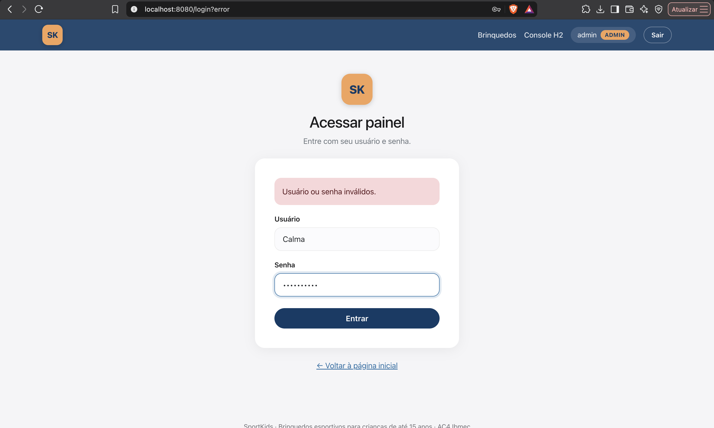

Tela de login depois de uma tentativa com usuário ou senha errados. O Spring Security recusa o acesso e a página mostra o aviso "Usuário ou senha inválidos." acima do formulário.

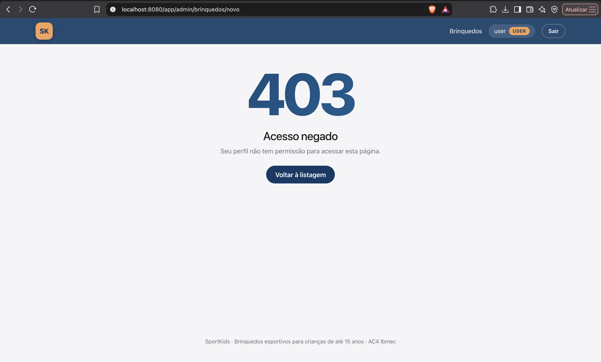

Logado como user, ao tentar abrir direto o endereço de cadastro `/app/admin/brinquedos/novo`, o sistema mostra a página 403 de acesso negado, já que essa área é só do administrador.

## 10. Interface web (Thymeleaf)

Todas as páginas reaproveitam o cabeçalho, o menu e o rodapé de `templates/fragments/layout.html` com `th:replace`, e o menu usa `sec:authorize` para mostrar as opções de acordo com o perfil de quem está logado.

### Landing page pública (`/`)

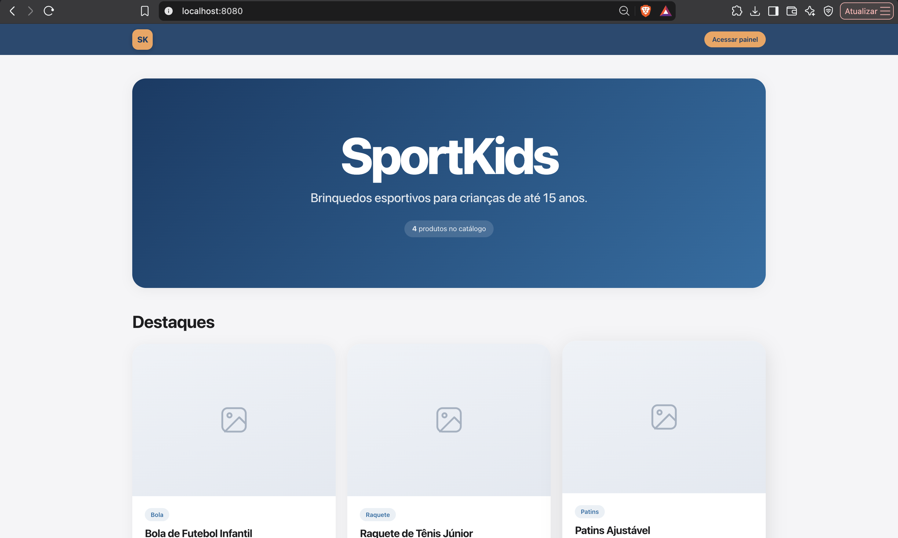

Página inicial vista por um visitante sem login. Ela apresenta a SportKids, o público de até 15 anos, o total de produtos do catálogo e os brinquedos em destaque. O botão "Acessar painel", no canto da barra superior, é o acesso que leva à tela de login.

### Listagem para o perfil USER

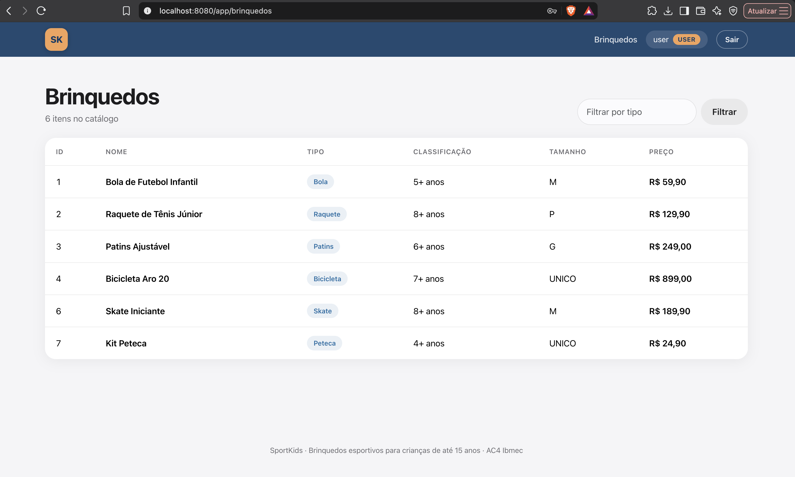

Logado como user, a listagem mostra todos os brinquedos com filtro por tipo, mas só para consulta: não há botão de novo cadastro nem coluna de ações.

### Listagem para o perfil ADMIN

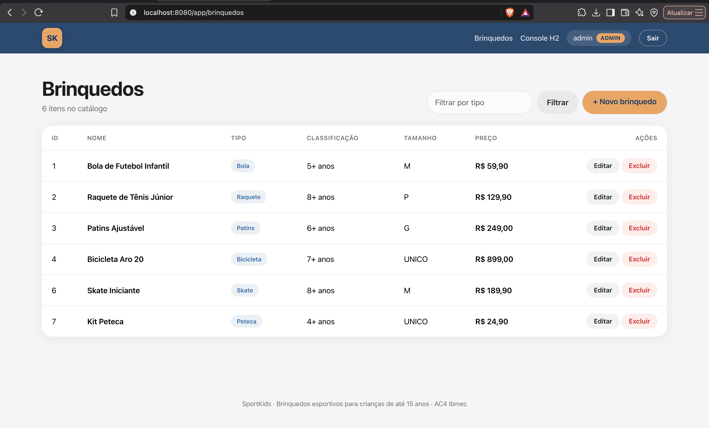

Logado como admin, a mesma listagem ganha o botão "Novo brinquedo", os botões de editar e excluir em cada linha e o link para o console H2 no menu.

### Formulário de cadastro com validação

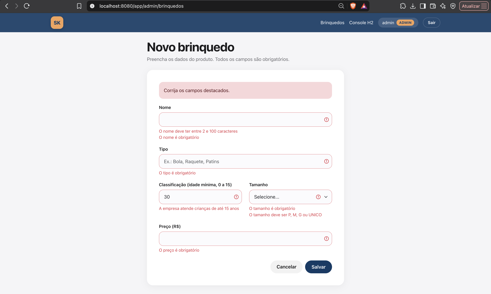

Formulário de novo brinquedo salvo com os campos vazios e classificação 30. As mensagens do Bean Validation aparecem embaixo de cada campo com problema, e nada é gravado até que tudo esteja correto.

## 11. Testes automatizados

A classe [`BrinquedoControllerTest`](src/test/java/br/com/ibmec/brinquedos/controller/BrinquedoControllerTest.java) usa `@SpringBootTest` com `MockMvc` e repete o roteiro do Postman: CRUD completo, validação com 400, cadastro em lote, faixa de preço com EntityManager, `id` ignorado no JSON, 401 sem login ou com senha errada, 403 para o USER tentando alterar dados, páginas públicas e área do ADMIN.

```
Tests run: 12, Failures: 0, Errors: 0, Skipped: 0 (BUILD SUCCESS)
```

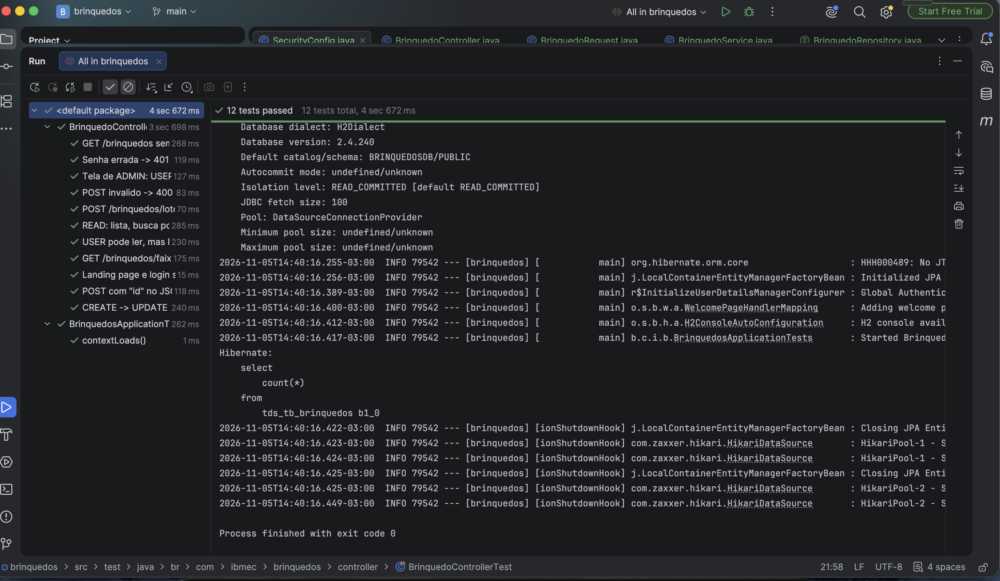

Execução de todos os testes no IntelliJ, com os 12 aprovados: os 11 da API, da segurança e das páginas, mais o teste que confere se a aplicação sobe.

## 12. Vídeo

O link do vídeo de apresentação será adicionado aqui em breve.
